# Kaiming（开明）

> 《山海经·海内西经》："开明兽……目视四方。" 开明兽守护昆仑九门，明察万物。
> 取"截取屏幕所见、辨识剪贴板内容、开启 Markdown 文档"之意。

Kaiming 是一个 macOS 菜单栏常驻的四合一原生效率工具，用同一个入口整合：

| 模块 | 能力 |
|---|---|
| 截图 | 区域 / 窗口 / 全屏三种模式（面板内卡片化入口，可直接切换截图后行为），按屏幕原生像素（4K/Retina）采集；AppKit 覆盖层框选与标注（画笔手写 / 矩形 / 箭头 / 文字 / 马赛克），已有标注可拖动、缩放、编辑文字或删除（⌘Z 撤销）；支持圆角（预览与 PNG 四角透明）与长截图（默认手动滚动、保留选区边框，可切换自动滚动）；完成后 PNG 自动进剪贴板，并可在面板内一键复制 / 保存；成品可选 macOS 标准窗口头部（红黄绿三个圆点，默认开启、设置可关闭）；可配置截图时是否隐藏 Kaiming 自己的窗口（默认**不隐藏**，Markdown 内容可直接截进图里） |
| 剪贴板 | 历史记录、类型识别、收藏与实时双 tab（收藏项永久保留、可随时移除，不占实时条数上限）、一键复制 / 清除；默认 ⌥⇧C 打开快捷选择窗口，↑/↓ 选中、Enter 复制、⌘D 收藏（快捷键可在设置中自定义） |
| 系统 | 内存 / CPU / 磁盘 / 网络实时采样；按应用聚合物理内存 footprint 与一键释放内存；用户缓存、日志、废纸篓扫描与清理（保留最近 1 小时的写入）；应用卸载（应用本体、共享/沙盒容器、缓存、偏好、日志、插件、用户目录同名项等，逐项可取消）；CPU 温度（IOHID 传感器）与风扇转速（AppleSMC），机型不支持时显示「—」；菜单栏可选展示温度 / 负载 / 风扇 / 内存 / 磁盘 / 上下行指标（默认全部） |
| Markdown | 独立 SwiftUI 窗口，Typora 式实时渲染（TextKit 2，GitHub 浅/深色内容主题）；项目文件夹预览与「最近项目」下拉、本地/远程图片、内部文件链接（目录联动）、纯标题大纲导航（点击可滚动定位编辑器/渲染预览）、非 Markdown 文件按类型语法高亮预览；整篇渲染预览改用 WKWebView（GitHub Markdown 样式、HTML 块、Mermaid 图表、跟随系统深浅色），支持页宽（默认/较宽/全宽）、⌘+滚轮缩放字号、导出 A4 PDF；编辑与渲染预览均支持 ⌘F 内嵌查找（正则 / 区分大小写，全部匹配高亮），编辑器支持替换当前 / 全部替换（正则替换支持 `$1` 捕获组）；渲染预览中的内部链接留在预览里跳转，不再弹出外部应用窗口；图标悬停提示；编辑 / 保存；支持 `kaiming ./docs` 从终端打开目录 |

纯 Swift 6 + Apple 原生框架。编辑器始终是原生 TextKit 2；只有「整篇渲染预览 / PDF 导出」
使用系统 WKWebView（离线、无外链资源），不引入跨平台抽象。


## 界面一览

| 菜单栏面板 | Markdown 实时渲染 |
|---|---|
| 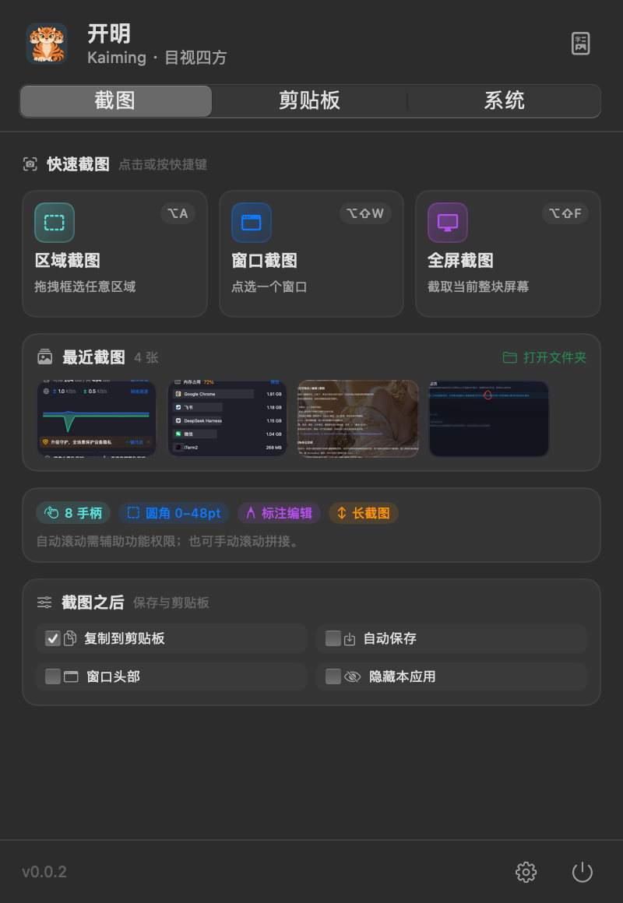 |  |

| Markdown 目录树 | 剪贴板快捷选择（⌥⇧C） |
|---|---|
| 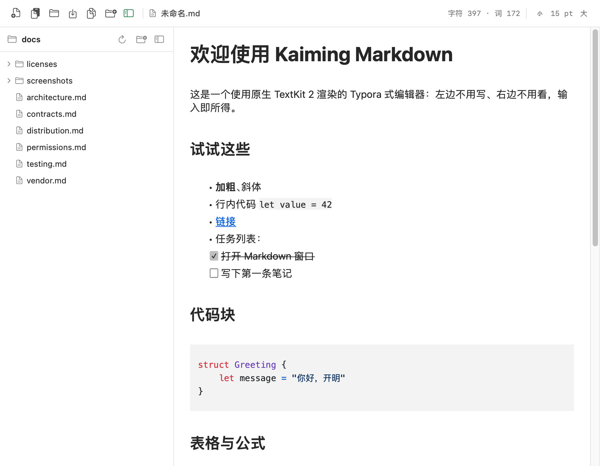 |  |

| 剪贴板历史 | 截图圆角 + 标注 |
|---|---|
| 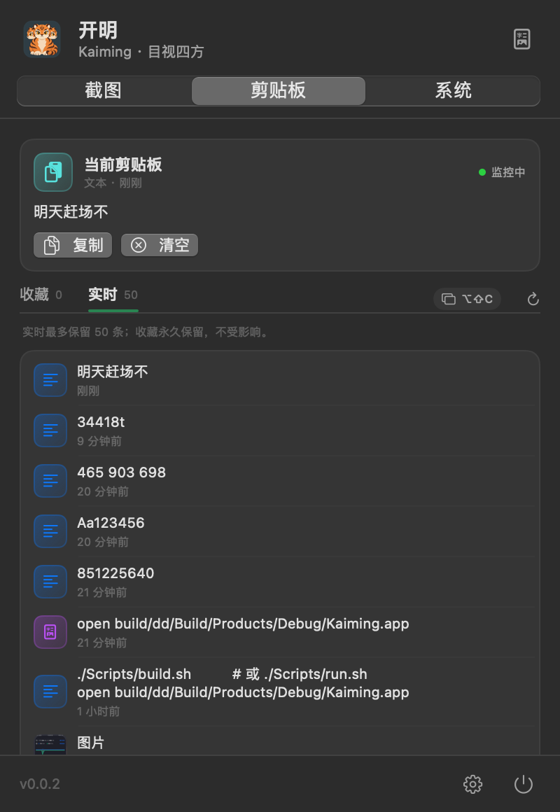 |  |

| 长截图（手动优先） | 项目文件夹预览 + 文本只读预览 |
|---|---|
|  | 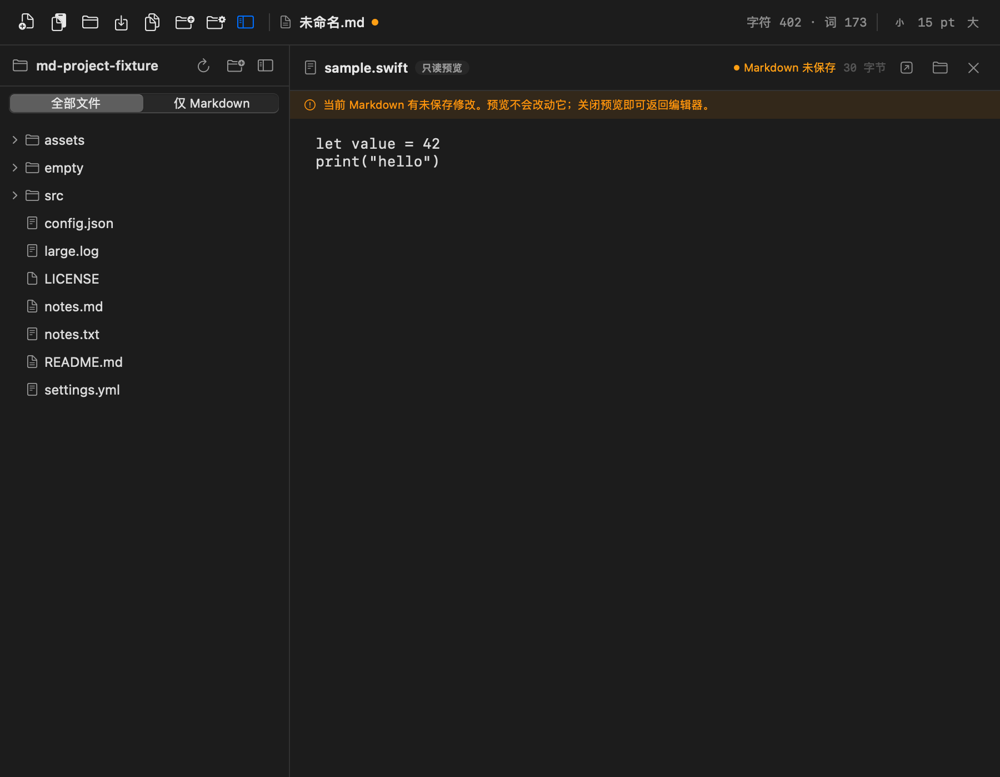 |

| 内容导航 + HTML 渲染预览 | 内部链接打开后目录联动 |
|---|---|
| 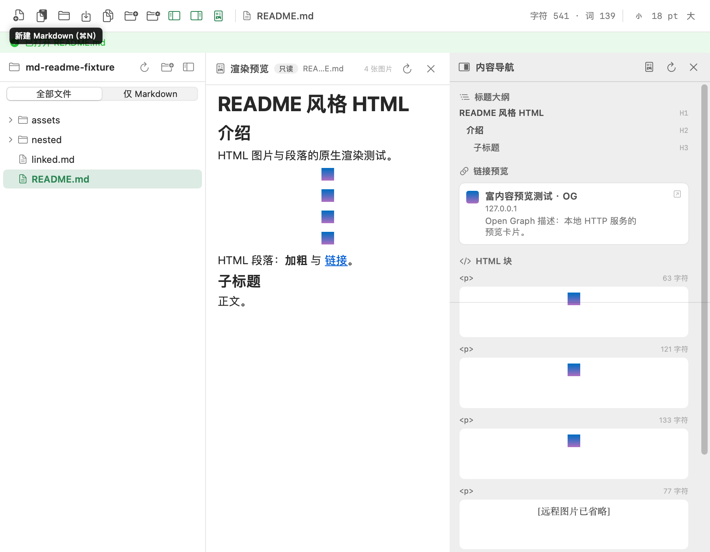 | 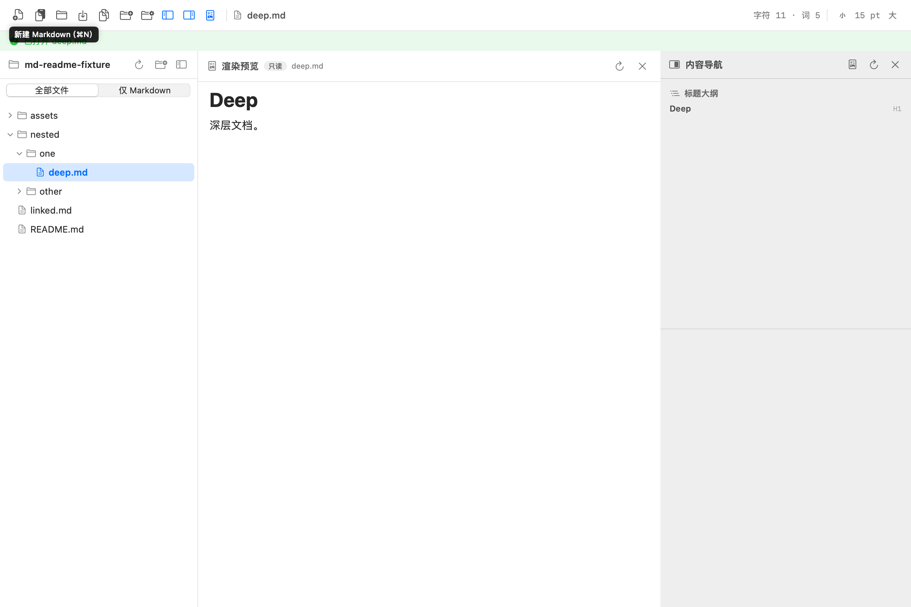 |

| 偏好设置 | 自定义快捷键（录制后保存生效） |
|---|---|
| 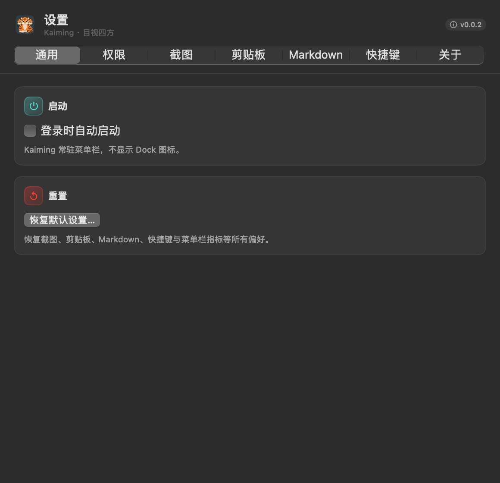 | 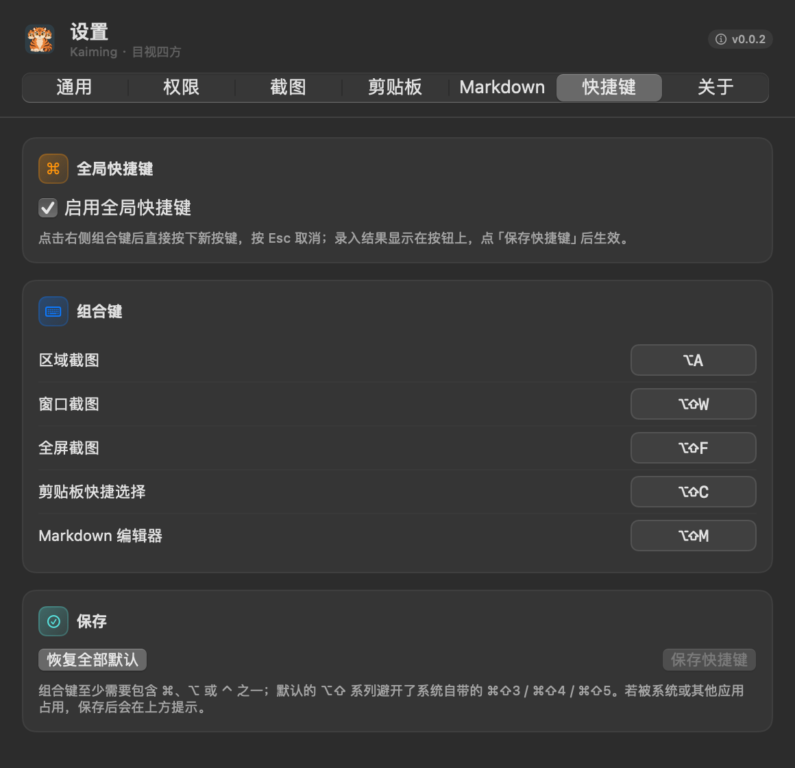 |

| 清理释放（内存 / 垃圾） | 系统功能（传感器 / 网络 / 磁盘） |
|---|---|
| 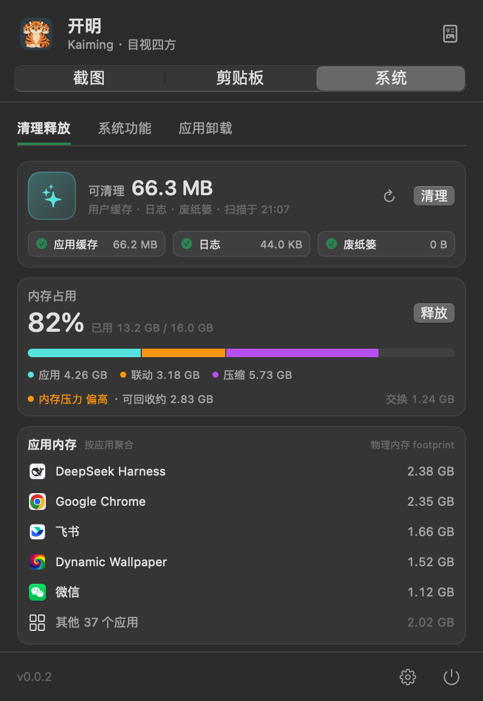 | 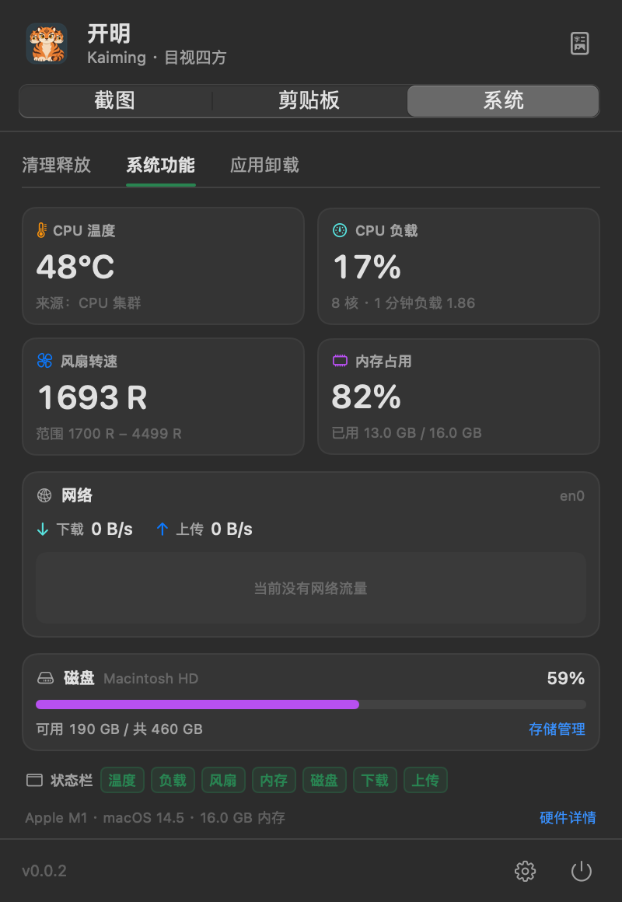 |

| 应用卸载（选择应用） | 卸载确认与关联文件 |
|---|---|
| 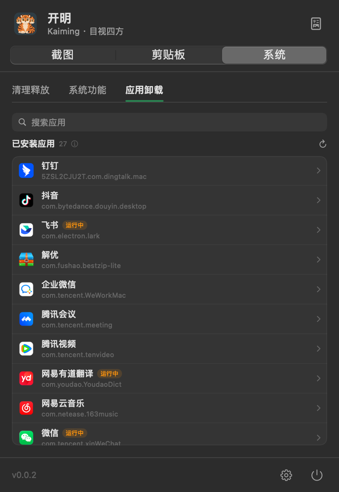 | 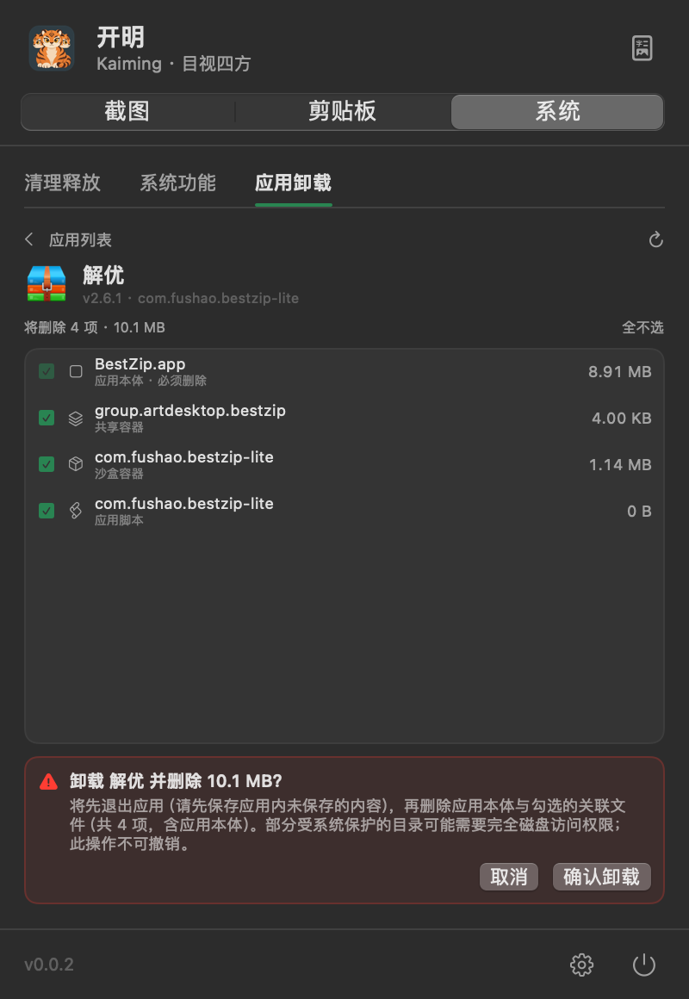 |

## 技术栈

| 模块 | 实现 |
|---|---|
| 应用骨架 | Swift 6 + SwiftUI；`MenuBarExtra(.window)` + 独立 `Window` scene（Markdown / 设置 / 剪贴板快捷选择）；Markdown 与剪贴板窗口统一出现在**鼠标所在屏幕**并跟随当前 Space（`WindowPlacement`）；`LSUIElement` 常驻菜单栏 |
| 截图核心 | ScreenCaptureKit：`SCShareableContent` → `SCContentFilter` → `SCStreamConfiguration` → `SCScreenshotManager.captureImage`（macOS 14+） |
| 截图覆盖层 | AppKit：每屏一个无边框 `.screenSaver` 层级 `NSWindow`，冻结截图 + 8 手柄选区 + CG 标注 |
| 剪贴板 | AppKit `NSPasteboard`，专用串行 `DispatchQueue` + `changeCount` 轮询 |
| Markdown | TextKit 2 原生编辑器（`swift-markdown-engine 0.15.0` 内嵌，见 [docs/vendor.md](docs/vendor.md)） |
| 全局快捷键 | Carbon `RegisterEventHotKey`；默认 ⌥⇧S / W / F / C / M，可在设置 → 快捷键点击录制、保存后生效 |
| 偏好设置 | 独立 `Window` scene + `UserDefaults`（`SettingsStore` 单一来源） |
| 系统资源 | `host_statistics64` / `host_processor_info` / `sysctl` / `getifaddrs` / `proc_pid_rusage`；温度走 `IOHIDEventSystemClient`（运行时解析符号），风扇走 IOKit AppleSMC；后台采样，面板收起即停止 |
| 应用卸载 | 枚举 `/Applications` 与 `~/Applications`；按 bundle id / 应用名扫描 `~/Library` 常见位置；删除前先退出应用，仅允许选中的应用本体与用户目录，失败项保留在详情提示 |

## 构建与运行

### Xcode

```bash
open Kaiming.xcodeproj
# 选择 Kaiming scheme，⌘R
```

要求：macOS 14+、Xcode 16+（Swift 6 工具链）。

### 命令行

```bash
# Debug 构建（DerivedData 留在工作区内，方便 CI/沙箱环境）
./Scripts/build.sh

# 构建并启动
./Scripts/run.sh
```

产物：`build/dd/Build/Products/Debug/Kaiming.app`。

> 工程包含两个 target：`Kaiming`（Swift 6，App）与 `MarkdownEngine`（Swift 5，内嵌第三方
> TextKit 2 渲染框架）。后者用 Swift 5 语言模式编译，避免对上游源码做大范围并发标注。

## 首次运行：屏幕录制权限

截图依赖 macOS 的「屏幕录制」TCC 权限：

1. 启动后菜单栏出现开明兽图标；点面板底部齿轮 → **设置 → 权限**。
2. 「权限」页统一列出屏幕录制与辅助功能：可检测当前状态、请求权限、打开系统设置、重置授权记录。
3. 授权后点「重启应用」或重新打开 Kaiming（TCC 对已运行进程不刷新）。

未授权时 ScreenCaptureKit 会**静默返回空列表**，因此 Kaiming 以真实采集能力判断权限，
并在失败时引导到「设置 → 权限」，不会静默失败。详见 [docs/permissions.md](docs/permissions.md)。

## 快捷键

默认组合键如下（设置 → 快捷键可逐项点击录制、点「保存快捷键」后生效）：

| 默认 | 动作 |
|---|---|
| ⌥⇧S | 区域截图 |
| ⌥⇧W | 窗口截图 |
| ⌥⇧F | 全屏截图（鼠标所在屏幕） |
| ⌥⇧C | 剪贴板快捷选择（↑/↓ 选择，Enter 复制，⌘D 收藏/取消收藏） |
| ⌥⇧M | 打开 Markdown 窗口 |

录制时按下组合键会立即显示在按钮上，保存后才重新注册；组合键至少需要 ⌘ / ⌥ / ⌃ 之一
（或单独的 F1–F20），重复组合键会在保存前拦截。被其他应用占用时，设置页「注册失败」区会
显示原因；也可关闭全局快捷键或调整占用的应用。

## 系统资源

面板「系统」页分「清理释放 / 系统功能 / 应用卸载」三块：

- **清理释放**：扫描当前用户的 `~/Library/Caches`、`~/Library/Logs` 与 `~/.Trash`（首次约数秒，
  每个目录最多统计 25 万个文件），勾选类别后清理；最近 1 小时内修改过的文件会保留。内存占用采用
  活动监视器口径（应用内存 + 联动 + 压缩），下方按 `.app` 聚合物理 footprint 列出前 5 个应用与
  「其他」；「释放」通过一次性申请并立即归还大块内存，促使内核回收闲置页，实际释放量按前后
  采样差值如实反馈。
- **系统功能**：CPU 温度 / 负载、风扇转速（含最小–最大范围）、内存占用、磁盘用量与实时网络
  上下行曲线。面板打开时每 2 秒刷新；收起后若状态栏仍有指标，降为每 3 秒轻量采样。
- **状态栏指标**：系统功能页底部的「状态栏」一行可按需开关温度 / 负载 / 风扇 / 内存 / 磁盘 / 下载 /
  上传，默认全部开启。菜单栏项目由开明图标 + 指标图标与紧凑数值组成（温度计、CPU、风扇、内存、
  磁盘、上下行箭头），例如温度计 62°、CPU 17%、风扇 1703、内存 80%、磁盘 59%、↓ 1.2M、↑ 0；
  选择写入 `UserDefaults`，全部关闭时菜单栏只保留开明图标，并停止后台采样。

  

- **应用卸载**：列出 `/Applications` 与 `~/Applications` 下除 Apple 系统应用与开明自身之外的 App；
  选择后扫描应用本体、`~/Library` 下的支持文件、共享容器（App Group entitlements）、沙盒容器、
  缓存、偏好设置、日志、窗口状态、WebKit/HTTPStorages/Cookies、应用脚本、插件/扩展与 LaunchAgents，
  以及 `~/Documents`、`~/Downloads`、`~/Desktop`、`~/Pictures`、`~/Movies`、`~/Music`、`~/Public`
  和家目录下与 App 同名的顶层文件/文件夹。默认全选、可逐项取消；用户目录项带橙色警告
  （可能包含个人资料），取消勾选即可保留。确认后先退出应用（请先保存），再删除应用本体与勾选内容；
  应用本体删除失败会立即中止，不留下被清掉缓存的坏应用。
  仅覆盖当前用户的常见位置：`/Library` 系统级文件、App Store 收据、用户目录的深层嵌套子目录与
  应用自定义目录不在范围内；部分 TCC 保护目录（如 Cookies、其他应用容器）在未授予完全磁盘访问
  权限时可能删除失败，失败项会保留在详情页提示。

传感器说明：Apple Silicon 的温度来自 `IOHIDEventSystemClient` 的 `pACC / eACC / PMU tdie`
传感器，相关符号用 `dlsym` 运行时解析；风扇来自 AppleSMC（`F0Ac`，兼容 `flt` / `fpe2`）。
读取失败（无风扇机型、机型差异）只显示「—」，不影响其他功能。

> 清理、释放与卸载都是本机操作，不上传数据；清空废纸篓与卸载应用不可撤销。面板内使用
> **内联确认**，不弹系统模态（菜单栏面板会在系统弹窗出现时收起，按钮 action 会丢失）。

## 命令行（CLI）

`kaiming ./docs` 会通过 `kaiming://` URL scheme 让正在运行的 Kaiming 在 Markdown 窗口中打开该目录；
传入 `.md` 文件则同时打开文件。

```bash
# 安装（若 /usr/local/bin 需要权限，用 sudo 或指定 ~/.local/bin）
./Scripts/install-cli.sh
# 或手动
ln -sf "$PWD/Scripts/kaiming" /usr/local/bin/kaiming

kaiming .            # 在当前目录打开文件树
kaiming ./docs       # 打开 docs 目录
kaiming ./README.md  # 打开文件所在目录并载入文件
```

也可以在 Markdown 窗口的「打开文件夹…」选择目录，效果相同。

## 数据目录

| 内容 | 路径 |
|---|---|
| 截图历史（最近 30 张） | `~/Library/Application Support/Kaiming/Captures/` |
| 剪贴板图片与历史元数据 | `~/Library/Application Support/Kaiming/Clipboard/` |
| 截图默认保存目录 | `~/Pictures/Kaiming/`（可在设置中修改） |

所有文件仅保存在本机，不上传网络。

## 项目结构

```
Kaiming.xcodeproj/          # 两个 target；File System Synchronized Groups
Config/                     # Info.plist（LSUIElement / 权限用途）、entitlements
Kaiming/
  App/                      # @main、AppDelegate、权限启动检查
  Shared/                   # SettingsStore、AppState、AppRouter、快捷键、日志、路径
  MenuBar/                  # MenuBarExtra 面板与标签
  Settings/                 # 偏好设置
  Screenshot/               # ScreenCaptureKit 采集 + AppKit 覆盖层 + 标注
  Clipboard/                # 串行队列监控 + 历史
  SystemMonitor/            # 采样、传感器、清理、内存释放、应用卸载
  Markdown/                 # 独立窗口 + 引擎适配
  Resources/                # 图标、highlight.js、mathFonts.bundle
MarkdownKit/                # 内嵌第三方源码（只读，独立 framework）
Scripts/                    # 构建 / 运行 / 签名 / 公证
docs/                       # 架构、权限、分发、测试、第三方说明；brand/ 为图标源图
```

## 架构与约束

- 菜单栏是唯一入口；Markdown 用独立 `Window` scene，不嵌入菜单栏面板或截图覆盖窗口。
- 模块之间**只通过 `NSPasteboard` 交换数据**；截图留档写入 `Application Support/Kaiming/Captures`
  并由截图模块自行维护（最近 30 张），不产生模块类型依赖。
- 所有剪贴板读写走专用串行队列；截图历史与剪贴板缓存不指向临时路径；权限失败必须有可操作提示。
- UI 框架策略：SwiftUI 为主；AppKit 用于截图覆盖层、Carbon 全局快捷键、剪贴板与图片处理所需的系统 API（NSPasteboard、NSImage），以及 Markdown 整篇渲染预览/PDF 导出使用的 WKWebView（WebKit 是系统框架，仅此一处）。

详见 [docs/architecture.md](docs/architecture.md)。

## GitHub Actions 打包

推送 `main`、`v*` tag 或手动运行 workflow 时，GitHub Actions 会在 `macos-15` 上：

1. 选择 Xcode 16+；
2. 构建 **universal（arm64 + x86_64）** Release 归档；
3. 生成 `Kaiming-<version>.zip`、`.dmg`、`SHA256SUMS.txt`；
4. 上传 artifact；tag 构建自动发布到 GitHub Release。

工作流：[`.github/workflows/package.yml`](.github/workflows/package.yml)，
说明见 [docs/ci.md](docs/ci.md)。CI 产物为 ad-hoc 签名，正式分发仍需 Developer ID +
公证（见分发文档）。

## 分发

```bash
# 1) Release 归档（默认 ad-hoc 签名）
./Scripts/archive.sh

# 2) 通用二进制归档
UNIVERSAL=1 ./Scripts/archive.sh

# 3) 生成 ZIP/DMG/校验和
./Scripts/package.sh build/export/Kaiming.app build/dist

# 4) 使用 Developer ID 签名 + 公证
export DEVELOPMENT_TEAM=ABCDE12345
export APPLE_ID=you@example.com
export APPLE_TEAM_ID=ABCDE12345
export APP_NOTARY_PASSWORD=xxxx-xxxx-xxxx-xxxx
./Scripts/archive.sh --sign
./Scripts/notarize.sh build/export/Kaiming.app
```

未签名/未公证的构建仅适合本机开发。Developer ID + 公证流程见 [docs/distribution.md](docs/distribution.md)。

> App Sandbox 默认关闭：Developer ID 分发不强制沙盒。
> `Config/Kaiming.entitlements` 是一份沙盒模板，**当前未接入 build settings**；启用沙盒需要在
> target 上显式设置 `CODE_SIGN_ENTITLEMENTS = Config/Kaiming.entitlements`，并给用户选择的目录
> 加上 security-scoped bookmark（详见分发文档）。

## 测试

自动化构建检查：

```bash
./Scripts/build.sh
```

手工验收清单（截图/剪贴板/Markdown/权限/重启保持）见 [docs/testing.md](docs/testing.md)。

## 第三方组件

| 组件 | 版本 | 许可 |
|---|---|---|
| swift-markdown-engine | 0.15.0 | Apache-2.0 |
| SwiftMath | 1.7.3 | MIT |
| highlight.js | 随 engine 0.15.0 | BSD-3-Clause |
| Mermaid | 11.17.2 | MIT |

许可证全文见 [docs/licenses](docs/licenses)。内嵌原因与补丁见 [docs/vendor.md](docs/vendor.md)。

## 已知限制

- 最低 macOS 14.0；不使用 macOS 26 的 `captureScreenshot` 一次性 API（其非前台 Space 返回 -3811 的已知问题与 14 基线不匹配）。
- 剪贴板的 `detectedPatterns`（macOS 15.4+）在 SDK 15.2 中不可用，类型识别使用 `changeCount` + pasteboard 类型检查。
- 屏幕录制授权与构建签名/CDHash 绑定：重新构建后系统设置可能仍显示已授权，但需要重启应用/重置权限。
  Kaiming 1.1.1 已改为以真实 ScreenCaptureKit 能力为准，权限的检测 / 申请 / 重置统一在「设置 → 权限」。
- 未做开机自启的失败重试；`SMAppService` 在未签名的开发构建上可能拒绝注册，设置页会显示系统错误。
- Markdown 渲染预览的远程图片保留原始 URL，由 WebView 并行渐进加载（需要网络；离线时远程图不显示，正文与本地图片不受影响）；PDF 导出仍会下载并内联远程图片（有界并发，失败降级为占位文字）。
- Markdown 渲染预览把 `mermaid.min.js`（约 3.5 MB）与 `highlight.min.js`（约 1 MB）内联进
  HTML，含图表/代码块的文档每次渲染会增加几 MB 内存与几十毫秒拼接耗时；图片按 20 MB/张
  上限内联为 `data:` URL，超大图片显示占位提示。PDF 分页按块级元素边界计算，超高单块
  （例如超过一页的表格）仍可能被行内切分。
- macOS 14 + `LSUIElement` 下 SwiftUI `Settings` scene 的 `showSettingsWindow:` 会返回 handled
  但不创建窗口（本机实测），因此偏好设置改用独立 `Window(id: "settings")`，功能等价，
  ⌘, 仍可用；这是对规格中「Settings scene」的一处有据可查的工程偏离。
- 截图按屏幕原生像素采集（本机 4K：3840×2160）；4K 长截图在高上限下内存占用较高。
- Markdown 的 HTML 块在「渲染预览」中由 **WKWebView** 真实渲染（编辑器内仍显示源码，含 HTML 块时出现一键预览提示条）；预览会先清洗 `<script>`/`<iframe>` 与 `on*` 事件，HTML 自带样式可生效。Mermaid 图固定使用深色画布（参考 Crescent 架构图风格），不随页面浅色主题重绘。
- 长截图默认进入**手动滚动**（保留选区边框，实时页面自行滚动）；点 HUD 的「自动滚动」才需要辅助功能（Accessibility）权限，未授权时保持手动。
- 系统页的温度 / 风扇依赖机型：Apple Silicon 走 IOHID 运行时符号 + AppleSMC，其它机型可能只显示「—」；
  风扇为 0 时不展示范围。温度读取使用 `IOHIDEventSystemClient` 的未公开符号（`dlsym` 动态解析），
  AppleSMC 也非公开 API；当前面向 Developer ID 分发，若需上架 App Store 应移除该路径（会自动降级为「—」）。
- 「释放内存」不是 root `purge`：通过短暂内存压力促使系统回收，效果因当前压力而异，界面只报告采样
  差值；缓存清理只覆盖当前用户目录，不触碰系统级缓存。
- 应用卸载扫描已知用户级位置（`~/Library` 常见目录 + 常用用户目录的顶层同名项）：`/Library` 系统级
  文件、App Store 收据、用户目录的深层嵌套子目录与应用自选的自定义目录不会被清理；部分 TCC 保护
  目录需要「完全磁盘访问权限」，否则删除失败并保留在详情提示。卸载会先退出应用，未保存内容请提前
  保存；应用拒绝退出时中止。用户目录同名项默认勾选但可能包含个人文档，确认前请逐项检查。
- 应用列表只包含 `/Applications`、`~/Applications` 下的非 Apple、非开明自身、非符号链接应用；
  同名的其他厂商目录由界面明确列出，可在卸载前取消勾选。
- 状态栏默认展示全部 7 项指标，菜单栏项目会较宽；可在系统功能页关闭不需要的指标，只保留 1–2 项。
- 未实现云端同步/多设备历史；所有数据仅本机。

Copyright © 2026 Kaiming.
